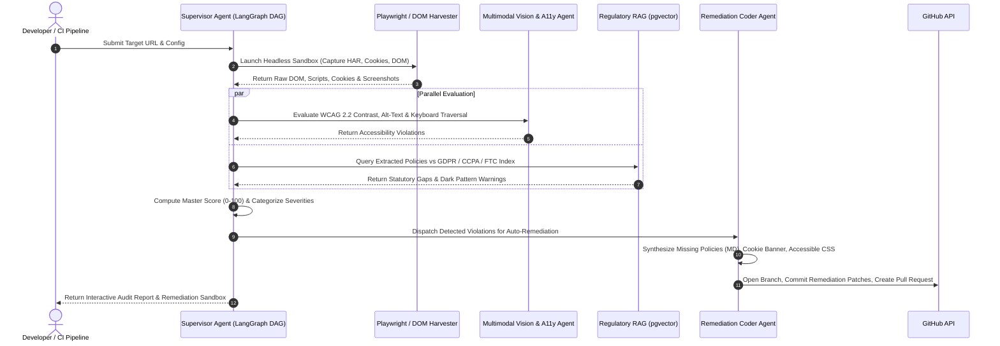

<div align="center">

# 🛡️ VIBEGUARD AI (AegisAgent)
### Autonomous Multi-Agent Governance, Legal & Accessibility Compliance Engine for AI-Generated & Vibe-Coded Web Applications

[](https://www.python.org/)
[](https://flask.palletsprojects.com/)
[](https://github.com/pgvector/pgvector)
[](https://github.com/langchain-ai/langgraph)
[](https://www.w3.org/WAI/standards-guidelines/wcag/)
[](LICENSE)

<br/>

**VibeGuard AI** is an enterprise-grade autonomous compliance platform that audits AI-generated ("vibe-coded") websites against global privacy regulations (GDPR, CCPA), truth-in-advertising laws (FTC), accessibility standards (WCAG 2.2 AA), and local statutory requirements. It automatically synthesizes missing legal policies and opens a ready-to-merge GitHub Pull Request in under 60 seconds.

<br/>

[Quick Start](#-quick-start) • [Simple Words Explanation](#-what-is-this-project-in-simple-words) • [The 11 Checkpoints](#-the-11-vibe-coded-inspection-vectors) • [GenAI Roadmap Stack](#-architectural-alignment-with-the-7-step-genai-roadmap) • [API Specs](#-api-endpoints)

---

</div>

## 💡 What is This Project in Simple Words?

### The Problem in Plain English
With tools like **Cursor, Claude 3.7, v0, Bolt.new, and Lovable**, anyone can "vibe code" an entire startup website or SaaS landing page in an afternoon just by typing prompts. 

While these websites look visually stunning, **95% of them are shipped with critical legal and technical mistakes**:
- They forget to include a **Privacy Policy** or **Terms of Service** (or leave fake placeholder text like `[Insert Company Name Here]`).
- They drop invasive **tracking cookies** on visitors *before* getting permission (illegal under EU GDPR and California CCPA, risking fines up to **€20 Million or 4% of annual revenue**).
- They have broken **color contrast** or lack keyboard navigation, making them unusable for visually impaired visitors (leading to **ADA Title III lawsuits** averaging $10,000–$50,000 in settlements).
- They display **exaggerated or fake AI-generated reviews** without disclaimers (violating FTC federal laws with civil penalties up to **$51,744 per violation**).

### What VibeGuard AI Does
**VibeGuard AI is your autonomous AI Legal Counsel and Accessibility QA Engineer.** 

You paste your website's URL into VibeGuard AI. In under 60 seconds:
1. **It Crawls Your Site:** An automated browser agent visits the URL, tests forms, checks buttons, and tracks every background script and cookie.
2. **It Audits 11 Critical Vectors:** It checks your site against a database of real laws (GDPR, CCPA, WCAG 2.2 AA, FTC guides).
3. **It Generates the Fixes Automatically:** It doesn't just give you a checklist of errors—it writes your bespoke **Privacy Policy**, generates an accessible **Cookie Banner**, writes **CSS color contrast overrides**, fixes your **form tags**, and creates a **ready-to-merge GitHub Pull Request** with all the code fixes.

---

## 📸 User Interface Preview

### 1. The Cyber-Luxe Glassmorphism Dashboard
*A futuristic, dark-mode glassmorphic interface with real-time agent telemetry, circular SVG score gauge, and 4-pillar risk analysis.*


### 2. Autonomous Remediation Sandbox Modal
*1-Click code generation: Ingests violations and synthesizes customized Markdown policies, accessible CSS overrides, and GitHub unified diffs.*


---

## 🔍 The 11 Vibe Coded Inspection Vectors

VibeGuard AI inspects and remediates all 11 critical points commonly neglected during AI vibe coding:

| # | Inspection Point | Real-World Risk & Failure Mode | Autonomous Agent Remediation |
|:---:|---|---|---|
| **01** | **Privacy Policy** | Missing page or unpopulated placeholders (`[Company Name]`). | Synthesizes a tailored, GDPR Art. 13 & CCPA compliant Privacy Policy mapped to the app's real endpoints. |
| **02** | **Terms & Conditions** | No governing law, arbitration clause, or AI liability disclaimer. | Generates complete Terms of Service with statutory limitation of liability clauses. |
| **03** | **Cookie Policy** | Uncategorized tracking, no declared cookie lifespans. | Scans browser storage and generates categorized cookie tables with statutory retention timelines. |
| **04** | **Refund Policy** | Missing EU 14-day statutory cooling-off revocation clauses. | Drafts clear statutory cancellation and digital goods refund policies. |
| **05** | **Cookie & Form Consent** | Dark patterns (pre-ticked boxes) or cookies dropped before opt-in. | Injects an accessible, zero-dependency GDPR cookie banner with prior-consent blocking logic. |
| **06** | **User Data Collected** | PII (email, phone, card) harvested without consent checkboxes. | Intercepts forms and enforces affirmative consent checkboxes and privacy notices. |
| **07** | **Third-Party Embeds** | Unvetted pixels (Meta, Google, Hotjar) leaking IP addresses. | Builds a sub-processor ledger and gates tracking scripts behind user consent. |
| **08** | **Alt Text & Contrast** | Images missing `alt` tags; text contrast < 4.5:1 (WCAG failure). | Uses Vision LLMs to generate contextual alt tags and recalibrates CSS colors to meet WCAG 2.2 AA. |
| **09** | **Keyboard Navigation** | Missing `<label>` tags, clickable `<div>`s without ARIA roles or focus. | Wraps inputs in `<label>` tags, restores semantic `<button>` tags, and injects `:focus-visible` styling. |
| **10** | **Fake Reviews & Claims** | Hallucinated testimonials or unsubstantiated revenue claims. | Flags synthetic marketing patterns and appends FTC-mandated "Results not typical" disclaimers. |
| **11** | **Copyright & Local Laws** | Unlicensed images or missing German Impressum statement. | Verifies image rights via perceptual hashing and generates statutory Impressum corporate records. |

---

## 🏗️ Architectural Alignment with the 7-Step GenAI Roadmap

VibeGuard AI is built from the ground up to embody every tier of modern AI engineering:

```
┌────────────────────────────────────────────────────────────────────────────────────────┐
│                        THE 7-STEP GENAI ROADMAP ALIGNMENT                              │
├────────────────────┬───────────────────────────────────────────────────────────────────┤
│ Step 1: Code Base  │ Async Python 3.12+, Relational PostgreSQL modeling, Git/GitHub Bot│
│ Step 2: Foundation │ Vision-Language Transformers (SigLIP/Claude) & Legal Self-Attention│
│ Step 3: LLMs       │ Token budgeting, 128k context windows, text-embedding-3-large     │
│ Step 4: Prompts    │ Chain-of-Thought (CoT), ReAct loops, strict Pydantic JSON schemas  │
│ Step 5: Hybrid RAG │ Parent-child chunking, pgvector HNSW indexing, BM25 + Cohere Rerank│
│ Step 6: Agents/MCP │ LangGraph Supervisor DAG, Headless Browser Tools, native MCP Server│
│ Step 7: Production │ Flask 3.0+ REST API, Gunicorn, Docker containers, AWS ECS Fargate │
└────────────────────┴───────────────────────────────────────────────────────────────────┘
```

---

## ⚙️ How It Works: Multi-Agent Orchestration Flow



---

## 📁 Project Directory Structure

```
d:\project\
├── app/
│   ├── __init__.py                # Flask application factory
│   ├── routes.py                  # API endpoints (/api/audit, /api/presets, /api/knowledge)
│   ├── engine/
│   │   ├── __init__.py            # Package exports
│   │   ├── crawler.py             # Headless DOM harvester & network analyzer
│   │   ├── auditor.py             # 11-Vector compliance evaluation engine
│   │   ├── rag_store.py           # Codified legal statutes (GDPR, CCPA, WCAG, FTC)
│   │   └── remediator.py          # Policy synthesizer & unified git diff generator
│   ├── templates/
│   │   └── index.html             # Glassmorphic cyber-luxe web dashboard
│   └── static/
│       ├── css/
│       │   └── glassmorphism.css  # Frosted glass styling, glowing accents, responsive layout
│       └── js/
│           └── app.js             # Telemetry stream controller, SVG gauge, modal logic
├── build/                         # UI screenshots and generated PRD artifacts
├── VibeGuard_AI_Enterprise_PRD.pdf# Full 9-Page Enterprise Specification Document
├── run.py                         # Application entrypoint (Runs Flask on port 5000)
├── requirements.txt               # Python package dependencies
└── README.md                      # Project documentation
```

---

## 🚀 Quick Start

### 1. Prerequisites
- Python 3.10+ (Tested on Python 3.12 and Python 3.14)
- Git

### 2. Installation
Clone the repository and install dependencies:
```bash
# Clone the repository
git clone https://github.com/your-username/vibeguard-ai.git
cd vibeguard-ai

# Install dependencies
pip install -r requirements.txt
```

### 3. Run the Web Application
```bash
python run.py
```
Open your browser and navigate to:
```
http://127.0.0.1:5000
```

### 4. Run an Instant Audit
1. Choose one of the quick presets:
   - **⚡ NovaFlow AI (SaaS Landing):** Demonstrates missing policies, unconsented telemetry, and WCAG contrast failures.
   - **🛍️ LuminaGlow (E-Commerce Store):** Demonstrates pre-ticked consent dark patterns and missing refund revocation rights.
2. Or enter any live public URL (e.g. `https://your-startup.com`) and click **⚡ Run Autonomous Audit**.
3. View the live multi-agent telemetry stream and inspect findings across all 11 checkpoint cards.
4. Click **✨ Auto-Remedy** to preview and copy the generated Markdown policies, CSS fixes, and GitHub PR diffs.

---

## 📡 API Endpoints

VibeGuard AI exposes a production REST API for integration into CI/CD pipelines, pre-commit hooks, or IDE extensions:

### 1. Dispatch Audit
```http
POST /api/audit
Content-Type: application/json

{
  "url": "https://novaflow-ai.vibe.dev",
  "company_name": "NovaFlow AI Inc."
}
```

**Response (Sample):**
```json
{
  "target_url": "https://novaflow-ai.vibe.dev",
  "master_score": 24,
  "critical_count": 2,
  "high_count": 4,
  "pillar_scores": {
    "legal_policies": 12,
    "consent_telemetry": 25,
    "accessibility_ux": 32,
    "authenticity_ip": 42
  },
  "checkpoints": [
    {
      "id": 1,
      "name": "Privacy Policy",
      "category": "Legal Policies",
      "status": "FAIL",
      "severity": "CRITICAL",
      "score": 0,
      "statute_violated": "GDPR Art. 13 & CCPA § 1798.100",
      "fine_risk": "Up to €20M / 4% global revenue",
      "evidence": "No hyperlink matching /(privacy|privacy-policy)/i found in DOM.",
      "remediation_summary": "Generate and link a comprehensive Privacy Policy declaring data controller and user rights."
    }
  ],
  "remediations": {
    "privacy_policy_md": "# Privacy Policy\n**Last Updated: September 28, 2026**...",
    "cookie_banner_html": "<div id=\"vibeguard-consent-banner\"...",
    "accessibility_css_patch": "/* WCAG 2.2 AA Contrast Overrides */...",
    "github_pr_diff": "diff --git a/index.html b/index.html..."
  }
}
```

### 2. Fetch Presets
```http
GET /api/presets
```

### 3. Query Regulatory Knowledge Base
```http
GET /api/knowledge
```

---

## 📄 Enterprise PRD Specification

A complete, 9-page executive **Product Requirements Document (PRD)** with high-resolution system topology diagrams, DDL schemas, and AWS deployment architecture is included in the root directory:

📄 **[VibeGuard_AI_Enterprise_PRD.pdf](VibeGuard_AI_Enterprise_PRD.pdf)**

---

## ⚖️ License & Disclaimers

Distributed under the **MIT License**. See `LICENSE` for more information.

*Disclaimer: VibeGuard AI provides automated heuristic and generative compliance auditing based on public regulatory corpora (GDPR, CCPA, FTC, WCAG 2.2). It does not constitute formal legal counsel. Organizations should have synthesized legal documents reviewed by licensed legal counsel before production deployment.*
